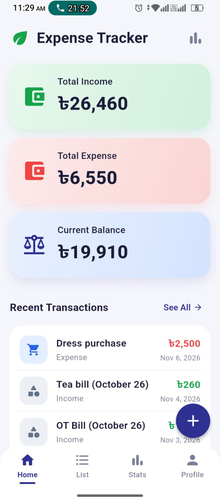
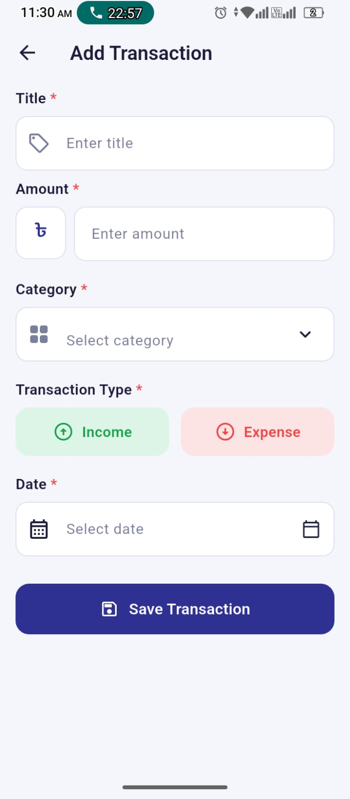
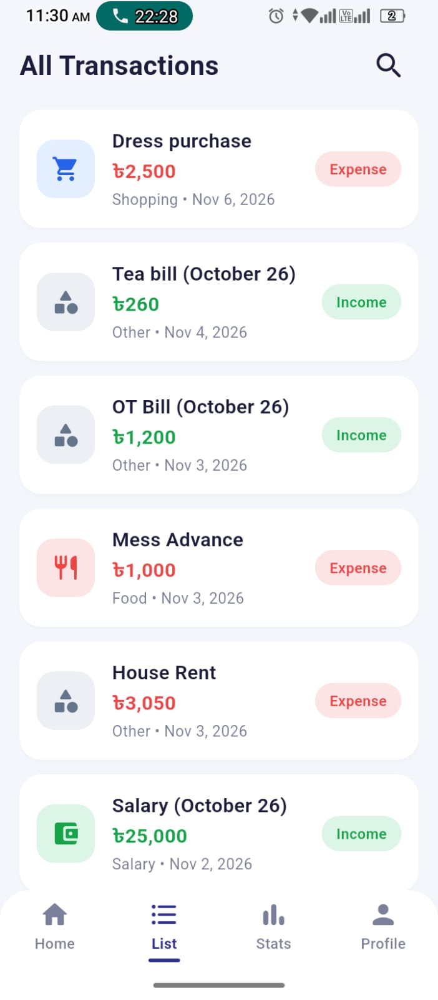
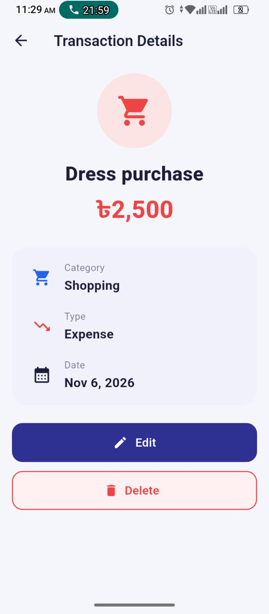
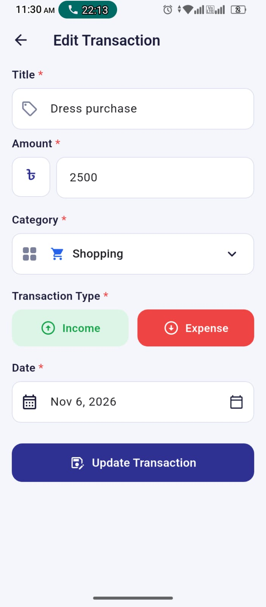
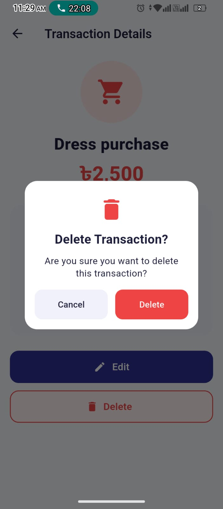
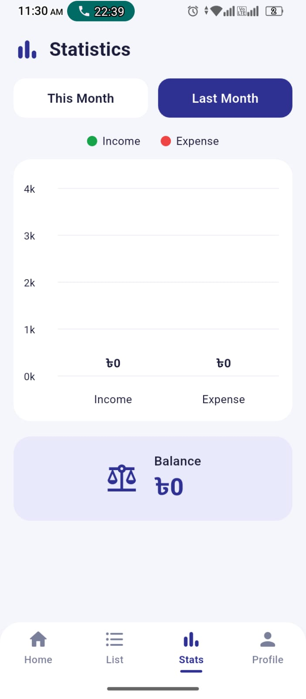
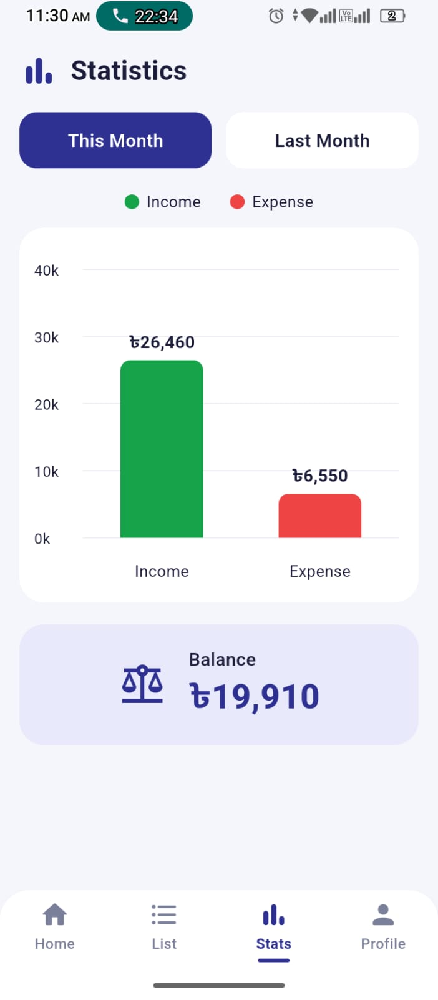
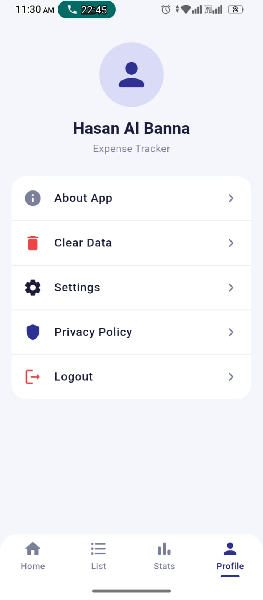

<div align="center">

# 💰 Expense Tracker

**A clean, offline-first Personal Expense Tracker built with Flutter.**
Add, view, update and delete your daily income & expenses, and watch your balance update live.


</div>

---

## 📸 Screenshots

<div align="center">
<table>
  <tr>
    <td align="center"><br/><sub><b>Dashboard</b></sub></td>
    <td align="center"><br/><sub><b>Add Transaction</b></sub></td>
    <td align="center"><br/><sub><b>All Transactions</b></sub></td>
  </tr>
  <tr>
    <td align="center"><br/><sub><b>Transaction Details</b></sub></td>
    <td align="center"><br/><sub><b>Edit Transaction</b></sub></td>
    <td align="center"><br/><sub><b>Delete Confirmation</b></sub></td>
  </tr>
  <tr>
    <td align="center"><br/><sub><b>Statistics</b></sub></td>
    <td align="center"><br/><sub><b>Statistics (This Month)</b></sub></td>
    <td align="center"><br/><sub><b>Profile</b></sub></td>
  </tr>
</table>
</div>

## ✨ Features

- 📊 **Dashboard** with three live summary cards: **Total Income**, **Total Expense** and **Current Balance**
- ➕ **Add** a transaction with a validated form (title, amount, category, type, date)
- 📋 **Transaction list** built with `ListView.builder`, colour-coded green for income and red for expense
- ✏️ **Edit** any transaction, with the form pre-filled with the saved data
- 🗑️ **Delete** with an `AlertDialog` confirmation; list and dashboard update instantly
- 🔍 **Details** screen with full information plus Edit / Delete actions
- 💾 **Persistent storage**: data survives closing and reopening the app (Sqflite)
- 📈 **Statistics**: This Month / Last Month income vs expense bar chart (custom-built, no chart package)
- 🔎 **Search** transactions by title, category or type
- 🧼 Empty, loading and error states handled on every list

---

## ✅ Assignment Checklist

| # | Requirement | Status | Where |
|---|---|:---:|---|
| 1 | Dashboard: app name, 3 summary cards, recent transactions, FAB | ✅ | `screens/dashboard`, `widgets/dashboard` |
| 2 | Add Transaction form with Title, Amount, Category (dropdown), Type, Date picker, Save | ✅ | `screens/add_transaction`, `widgets/form` |
| 3 | Validation: title, positive amount, category, type | ✅ | `core/utils/validators.dart` |
| 4 | Transaction list via `ListView.builder` with different colours for income/expense | ✅ | `screens/transaction_list` |
| 5 | Update transaction with previously saved data, saved to DB | ✅ | `screens/edit_transaction` |
| 6 | Delete with `AlertDialog`, list + summaries refresh | ✅ | `widgets/common/confirm_dialog.dart` |
| 7 | Transaction details with Edit & Delete options | ✅ | `screens/transaction_details` |
| 8 | Sqflite: `expense_tracker.db`, table `transactions` | ✅ | `core/database`, `data/` |
| 9 | Data persists after restarting the app | ✅ | SQLite file storage |

---

## 🛠️ Tech Stack

| Technology | Purpose |
|---|---|
| **Flutter** (Material 3) | UI framework |
| **Dart 3.7+** | Language |
| **flutter_riverpod 3.x** | State management & dependency injection (`AsyncNotifier`, `Notifier`, `Provider`) |
| **sqflite 2.4** | Local SQLite database |
| **path** | Building the database file path |
| **intl** | Date and number formatting |
| **flutter_test** | Unit tests |
| **flutter_lints** | Static analysis rules |

---

## 🏗️ Architecture

The project follows **Clean Architecture** with three layers plus a shared `core`:

```
┌────────────────────────────────────────────────────────┐
│ Presentation   screens · widgets · Riverpod providers  │
├────────────────────────────────────────────────────────┤
│ Domain         entities · use cases · repository (abs) │
├────────────────────────────────────────────────────────┤
│ Data           models · data source · repository impl  │
├────────────────────────────────────────────────────────┤
│ Core           constants · theme · utils · database    │
└────────────────────────────────────────────────────────┘
```

**Data flow**

```
UI  →  Provider / Notifier  →  UseCase  →  Repository  →  DataSource  →  Sqflite
```

The domain layer is pure Dart: it knows nothing about Flutter or SQLite, which keeps the business logic easy to test.

### 📁 Folder structure

```
lib/
├── main.dart
├── app.dart
├── core/
│   ├── constants/        app_colors, app_strings, app_categories, db_constants, ...
│   ├── database/         database_helper.dart
│   ├── theme/            app_theme, app_input_decoration
│   └── utils/            validators, currency_formatter, date_formatter, chart_axis
├── data/
│   ├── models/           transaction_model.dart
│   ├── datasources/      transaction_local_datasource.dart
│   └── repositories/     transaction_repository_impl.dart
├── domain/
│   ├── entities/         transaction_entity, transaction_type, transaction_summary
│   ├── repositories/     transaction_repository.dart (abstract)
│   └── usecases/         get · add · update · delete · clear · calculate_summary · monthly
└── presentation/
    ├── providers/        Riverpod providers & notifiers
    ├── navigation/       app_navigator.dart
    ├── screens/          main · dashboard · add · edit · list · details · statistics · profile
    └── widgets/          common · dashboard · form · transaction · details · statistics · profile · navigation
```

---

## 🧠 State Management

| Provider | Type | Responsibility |
|---|---|---|
| `transactionsProvider` | `AsyncNotifier` | Single source of truth: loads from SQLite and reloads after every add / update / delete |
| `summaryProvider` | `Provider` | Total income, total expense and balance, derived from the transactions |
| `recentTransactionsProvider` | `Provider` | Latest transactions for the dashboard |
| `filteredTransactionsProvider` | `Provider` | Search results for the list screen |
| `monthlyStatsProvider` | `Provider` | This / last month totals for the chart |
| `transactionByIdProvider` | `Provider.family` | Keeps the details screen in sync after an edit |
| `bottomNavIndexProvider` | `Notifier` | Active bottom-navigation tab |

Because every value is derived from `transactionsProvider`, the dashboard, list and statistics update automatically whenever a transaction changes.

---

## 🗃️ Database

- **Database name:** `expense_tracker.db`
- **Table name:** `transactions`

```sql
CREATE TABLE transactions (
  id       INTEGER PRIMARY KEY AUTOINCREMENT,
  title    TEXT NOT NULL,
  amount   REAL NOT NULL,
  category TEXT NOT NULL,
  type     TEXT NOT NULL,   -- 'income' | 'expense'
  date     TEXT NOT NULL    -- ISO-8601 string
)
```

---

## 🔒 Validation Rules

| Field | Rule |
|---|---|
| Title | Cannot be empty |
| Amount | Must be a valid number greater than 0 |
| Category | Must be selected |
| Transaction type | Income or Expense must be selected |
| Date | Must be selected |

---

## 🚀 Getting Started

### Prerequisites

- [Flutter SDK](https://docs.flutter.dev/get-started/install) (Dart 3.7 or newer)
- Android Studio or VS Code with the Flutter extension
- An Android / iOS emulator or a physical device

### Run the app

```bash
# 1. Clone the repository
git clone https://github.com/hasanalbannadev/expense_tracker_app.git
cd expense_tracker_app

# 2. Install dependencies
flutter pub get

# 3. Run
flutter run
```

### Analyze & test

```bash
flutter analyze   # static analysis
flutter test      # unit tests
```

> The app uses `sqflite`, so run it on **Android or iOS**.

---

## 🧪 Tests

Unit tests cover:

- Income / expense / balance calculation
- Entity ⇄ model ⇄ database map conversion
- All form validators
- Currency formatting and chart axis calculation

---

## 🔮 Future Improvements

- Editable profile name
- Category-wise expense breakdown
- Export transactions to CSV
- Dark theme

---
## 👤 Author

**Hasan Al Banna**
Flutter Developer

🌐 Portfolio: [https://hasanalbannadev.github.io/]
💻 GitHub: [@hasanalbannadev](https://github.com/hasanalbannadev)

---

<div align="center">

⭐ If you found this project useful, please give it a star!

</div>
